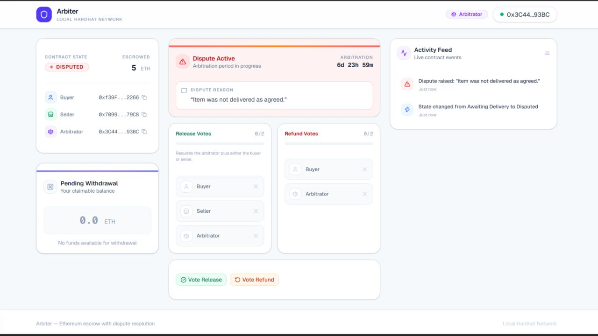
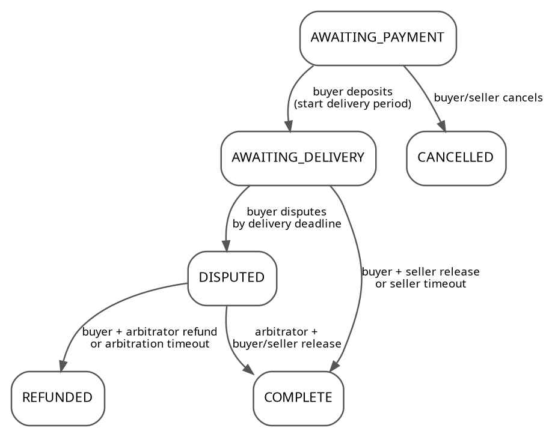

# Arbiter

**Ethereum escrow with three-party dispute resolution.**

Arbiter is a local Ethereum escrow dApp built around a Solidity state machine for a buyer, seller, and neutral arbitrator. It supports deposits, bilateral release approval, buyer-raised disputes, arbitration voting, deadline extensions, timeout recovery, and pull-payment withdrawals.

> **Project context:** Arbiter originated as a Semester-6 Smart Contracts course project and was later refactored for clearer structure, documentation, reproducibility, and portfolio presentation while preserving the original escrow scope.

The repository is intentionally scoped as a **single-escrow, local-development project**. It is designed to make the contract lifecycle, security decisions, tests, and frontend integration easy to inspect and demonstrate. There is no public-network deployment requirement.

## Application Preview



## How the escrow works

The contract has six states:

1. `AWAITING_PAYMENT` - the contract has been deployed and is waiting for the buyer to deposit ETH.
2. `AWAITING_DELIVERY` - funds are escrowed while the buyer and seller complete the transaction.
3. `DISPUTED` - the buyer has raised a dispute and the arbitrator can participate in resolution.
4. `COMPLETE` - funds have been queued for the seller.
5. `REFUNDED` - funds have been queued for the buyer.
6. `CANCELLED` - the escrow was cancelled before a deposit.

During normal settlement, both the buyer and seller must approve release. During a dispute, release requires the arbitrator plus either the buyer or seller; a refund requires the buyer and arbitrator.

The configured **delivery period begins when the buyer deposits**. Before funding, there is no active delivery deadline. If an undisputed funded escrow passes its delivery deadline, the seller can claim the timeout. The buyer may raise a dispute up to and including the delivery deadline; doing so replaces the active deadline with a seven-day arbitration deadline. Once that arbitration deadline has passed, release/refund voting is closed and the timeout path refunds the buyer. Deadline-extension proposals must also be proposed and accepted before the active delivery deadline expires.

### State-transition overview



## Security-oriented design

The contract uses deliberately simple protections that fit the current scope:

- role and state checks on lifecycle actions;
- distinct buyer, seller, and arbitrator addresses;
- cross-vote prevention during dispute resolution;
- a pull-payment model that queues funds before withdrawal;
- checks-effects-interactions ordering in `withdraw()`;
- reentrancy protection on the external-value-transfer withdrawal path;
- rejected direct ETH transfers so deposits must use `deposit()`;
- explicit timeout recovery paths when a required participant or arbitrator stops responding.

These controls do **not** make the project audited or production-ready financial software. Arbiter is an educational project running against a local Hardhat network.

## Tech stack

### Smart contract

- Solidity 0.8.24
- Hardhat
- Ethers v6
- Chai / Hardhat matchers
- TypeChain

### Web application

- Next.js 16
- React 19
- TypeScript
- wagmi 3
- viem 2
- TanStack Query
- React Hook Form + Zod
- Tailwind CSS
- shadcn/base-ui components
- Framer Motion
- Sonner

### Version policy

The repository targets **Node.js 24 LTS**. Core framework dependencies are pinned to current stable releases within the existing architecture: Hardhat remains on the maintained 2.x line rather than forcing a Hardhat 3 migration, while Next.js, React, wagmi, viem, Ethers, Tailwind CSS, and their matching type/config packages are refreshed to current compatible releases.

Because dependency lockfiles must be regenerated by npm for the refreshed dependency graph, run the install commands below once on a machine with npm registry access. npm will create new `package-lock.json` files; commit those generated lockfiles before treating a specific dependency graph as fully frozen.

## Repository structure

```text
arbiter-escrow/
├── .github/
│   └── workflows/
│       └── ci.yml
├── contracts/
│   ├── Escrow.sol
│   └── test/
│       └── EscrowReceivers.sol
├── docs/
│   ├── arbiter-dispute.jpg
│   └── state-machine.png
├── scripts/
│   ├── deploy.ts
│   └── verify-local.ts
├── test/
│   └── Escrow.test.ts
├── web/
│   ├── src/
│   │   ├── app/
│   │   ├── components/
│   │   ├── config/
│   │   ├── hooks/
│   │   ├── lib/
│   │   └── types/
│   ├── .env.example
│   └── package.json
├── .nvmrc
├── LICENSE
├── hardhat.config.ts
├── package.json
└── README.md
```

## Local setup

### Prerequisites

- Node.js 24.x (LTS)
- npm

A browser wallet is optional. The UI includes deterministic local Hardhat accounts for Buyer, Seller, and Arbitrator, so the complete demo can run without importing development private keys into a wallet extension.

If you use `nvm`, run `nvm use` from the repository root; the included `.nvmrc` selects Node.js 24.

### 1. Install dependencies

From the repository root:

```bash
npm install
npm --prefix web install
```

### 2. Start the local Ethereum node

```bash
npm run node
```

Leave that terminal running. Restarting the Hardhat node resets the local chain.

### 3. Deploy the escrow

In a second terminal:

```bash
npm run deploy
```

The deployment script uses the first three deterministic Hardhat accounts as Buyer, Seller, and Arbitrator. It then writes the deployed contract address and compiled ABI to `web/src/config/escrow-contract.ts`, keeping the frontend synchronized with the current local deployment.

### 4. Verify the local deployment

With the Hardhat node still running:

```bash
npm run verify:local
```

This checks that bytecode exists at the frontend's configured address and that the deployed Buyer, Seller, and Arbitrator match the expected local Hardhat accounts.

### 5. Start the web app

```bash
npm run web:dev
```

Open `http://localhost:3000`.

The default RPC endpoint is `http://127.0.0.1:8545`. To use another local endpoint, copy `web/.env.example` to `web/.env.local` and update `NEXT_PUBLIC_HARDHAT_RPC_URL`.

## Local demo accounts

The application exposes these deterministic Hardhat participants directly in the connection screen:

| Role | Address |
| --- | --- |
| Buyer | `0xf39Fd6e51aad88F6F4ce6aB8827279cffFb92266` |
| Seller | `0x70997970C51812dc3A010C7d01b50e0d17dc79C8` |
| Arbitrator | `0x3C44CdDdB6a900fa2b585dd299e03d12FA4293BC` |

These are development-only accounts from the deterministic local Hardhat node. They are not application credentials and must not be used for real funds.

## Suggested demo walkthrough

### Normal settlement

1. Connect as **Buyer** and deposit a small local ETH amount.
2. As Buyer, approve release.
3. Disconnect and connect as **Seller**.
4. Approve release. The escrow moves to `COMPLETE` and queues the payout.
5. Withdraw the queued funds as Seller.

### Dispute resolution

Start from a fresh local deployment (`npm run deploy` while the same node is running, or restart the node and deploy again):

1. Connect as **Buyer** and deposit local ETH.
2. Raise a dispute with a short reason.
3. Disconnect and connect as **Arbitrator**.
4. Vote for either release or refund.
5. Switch to the required second participant and cast the matching vote.
6. Withdraw the queued payout after the escrow reaches its final state.

Timeout paths use real contract timestamps and are covered by the automated Hardhat tests, so a reviewer does not need to wait for the UI deadline during a short demo.

## Development scripts

From the repository root:

```bash
npm run compile        # Compile the Solidity contract
npm test               # Run the Hardhat contract tests
npm run node           # Start the local Hardhat node
npm run deploy         # Deploy and synchronize frontend address + ABI
npm run verify:local   # Verify the deployed local contract and participant roles
npm run web:dev        # Start the Next.js development server
npm run web:lint       # Run frontend ESLint
npm run web:typecheck  # Run TypeScript without emitting files
npm run web:build      # Create a production Next.js build
npm run check          # Run contract + frontend verification commands
```

## Automated verification

The GitHub Actions workflow in `.github/workflows/ci.yml` runs two independent jobs on pushes to `main` and on pull requests:

- contract compilation and Hardhat tests;
- frontend linting, TypeScript checking, and the Next.js production build.

The workflow performs verification only. It does **not** deploy the contract or frontend to a public network.

## Test coverage

The Hardhat suite currently defines **76 contract test cases** covering the important workflows, including:

- constructor validation and participant roles;
- deposits and pre-deposit cancellation;
- normal release voting;
- seller timeout settlement;
- dispute creation and arbitration deadlines;
- disputed release and refund voting;
- arbitration timeout refunds;
- extension proposals, acceptance, cancellation, and expiry boundaries;
- pull-payment withdrawals, failed-recipient handling, and a recursive-withdrawal attack attempt;
- participant-identity validation, exact deadline boundaries, view helpers, fund-conservation checks, and rejected direct ETH transfers.

Run the suite with:

```bash
npm test
```

## Frontend behavior

The UI is role-aware and adapts to the connected Buyer, Seller, Arbitrator, or spectator. It polls current contract state, subscribes to live contract events, retrieves the latest dispute reason from historical `DisputeRaised` logs, prevents duplicate action submissions while a transaction is confirming, closes dispute voting/extension actions when their on-chain deadlines expire, and surfaces contract/network read failures instead of treating them as a valid escrow state.

## Current limitations

The scope is deliberately small and explicit:

- the application targets a local Hardhat network only;
- one deployed escrow address is configured at a time;
- the activity feed shows live events observed during the current browser session, although the active dispute reason is recovered from chain history;
- there is no external smart-contract security audit;
- there is no backend, database, account system, public-network deployment, or production deployment configuration.

These are project boundaries, not completed capabilities.

